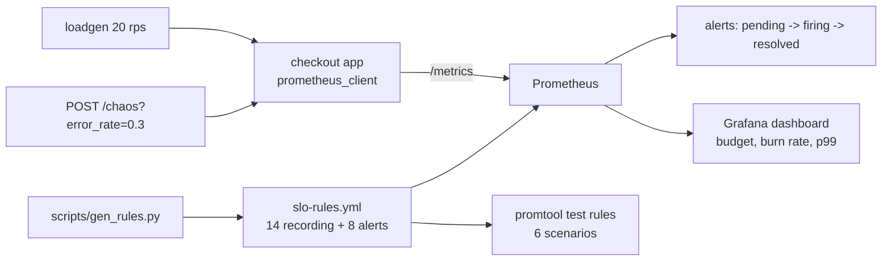

# SLO Lab — multi-window multi-burn-rate alerts, unit-tested and chaos-tested

> **Lab project.** A synthetic "checkout" service with a chaos knob. The live run used the real Prometheus 3.15 binary locally. Docker Compose and Grafana are provided but **were not run** (Docker not run yet). 

## Problem
"Alert when error rate > 5%" either pages at 3 a.m. for a 2-minute blip or stays silent while a slow leak eats the month's budget. SLO burn-rate alerting asks a better question: **how fast are we spending the error budget?** This lab defines 2 SLOs and generates the SRE Workbook's 4-tier multi-window alerts. It **unit-tests them with promtool** and then triggers them for real with fault injection.

| SLO | Target (30d) | Budget | SLI |
|---|---|---|---|
| Availability | 99.5% | 0.5% | non-5xx / all `/checkout` requests |
| Latency | 99% < 300 ms | 1% | `le="0.3"` bucket / count |

| Tier | Long / short window | Burn rate | Avail. threshold | for | Severity |
|---|---|---|---|---|---|
| 1 | 1h / 5m | 14.4× | 7.2% | 2m | page |
| 2 | 6h / 30m | 6× | 3% | 15m | page |
| 3 | 1d / 2h | 3× | 1.5% | 1h | ticket |
| 4 | 3d / 6h | 1× | 0.5% | 3h | ticket |

## Architecture


## Run
```bash
pip install -r app/requirements.txt pytest pyyaml
pytest -q                                           # needs promtool on PATH
cd prometheus && promtool test rules alerts_test.yml && cd ..
./scripts/live-demo.sh                              # no Docker: app + loadgen + prometheus binary, ~12 min
docker compose up --build                           # Grafana :3000, Prometheus :9090 (not run here)
curl -XPOST 'localhost:8000/chaos?error_rate=0.3'
```

## Results (actual runs, 2026-10-11, Prometheus/promtool 3.15.0)
**Unit tests:** `promtool test rules` passes 6 scenarios: hard outage pages within 2m, healthy at 0.2% never fires, a 5-minute blip doesn't keep paging, a 2× slow burn raises only the 3d ticket, 5% slow requests raise only the 1d latency ticket, and the zero-5xx regression. `pytest` **6/6**, including a **mutation test** (raising the fast-burn threshold to 0.5 must make promtool fail) and an app chaos test.

**Live chaos run** (`results/live-demo.log`, IST):
| Time | Event | err ratio (5m) | Alerts |
|---|---|---|---|
| 15:52:23 | healthy 2 min | 0 | none |
| 15:52:23 | chaos: 30% errors | — | — |
| 15:53:23 | +60 s | 9.7% (> 7.2%) | 1h page **pending**, slower tiers pending |
| 15:55:23 | +180 s | 18.4% | **CheckoutSLOAvailabilityBurn1h firing** |
| 15:56:23 | recover (0% errors) | — | still firing (5m window still above 7.2%) |
| 16:00:24 | +4 min after recovery | 5.2% | 1h page **resolved** because the short window dropped below threshold |

Time to page ≈ 3 min (1 min for the 5m rate to cross 7.2% + `for: 2m`). Time to resolve ≈ 4 min after the fix. This is the "short window = fast reset" property working as designed.

**Bug found by the live run:** in the first run (`results/live-demo-run1-bug.log`) the healthy-phase error ratio was `n/a`, not 0. With no 5xx yet there is no 5xx series, so `sum(rate(5xx))/sum(rate(all))` is an empty vector, and dashboards and `absent()`-style logic go blank. Fixed with `(sum(...) or vector(0))` and pinned by promtool test 6 (verified to fail on the old rule).

## Limitations
- **Not run:** docker compose, Grafana (dashboard JSON + provisioning are untested), Alertmanager routing.
- The live run lasts minutes, so 1h/6h/3d windows only contain those minutes. Slower tiers went `pending` but couldn't reach their `for:` durations. Their behaviour is covered only by promtool unit tests.
- "Error budget remaining" on the dashboard uses the 3d ratio as a proxy for 30d (lab has no 30d retention).
- Single instance, no OpenTelemetry traces, no Sloth/Pyrra generator comparison yet.

## Sources
- Google SRE Workbook, Alerting on SLOs — https://sre.google/workbook/alerting-on-slos/
- Prometheus unit testing rules — https://prometheus.io/docs/prometheus/latest/configuration/unit_testing_rules/
- Sloth (SLO generator) — https://github.com/slok/sloth
- Inspiration: https://github.com/amirhosssein0/observability-lab

## Related work

This is my own implementation. Ideas came from [amirhosssein0/observability-lab](https://github.com/amirhosssein0/observability-lab) and the Google SRE Workbook.
